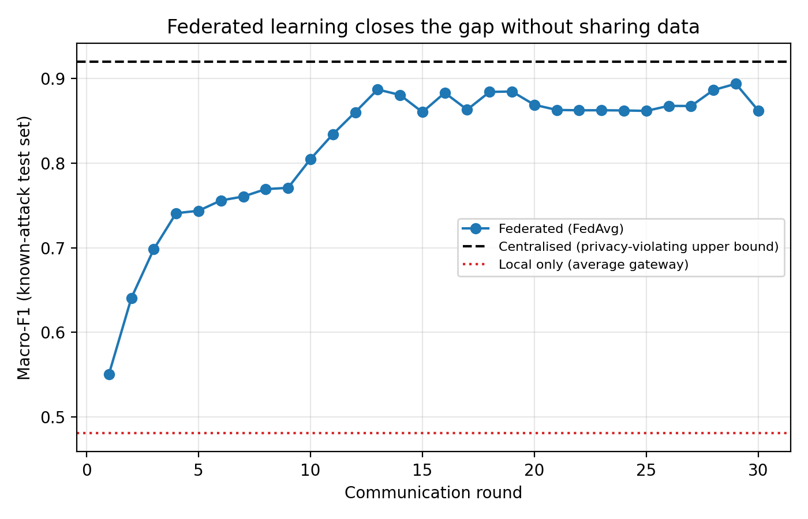
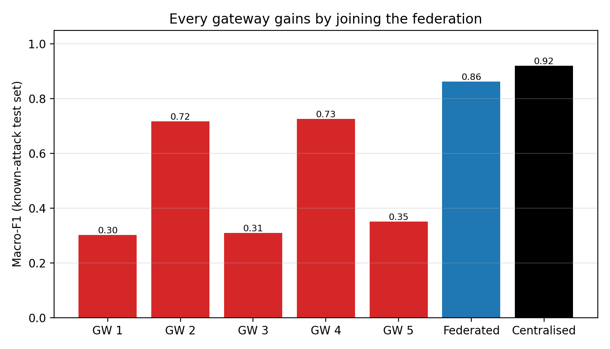
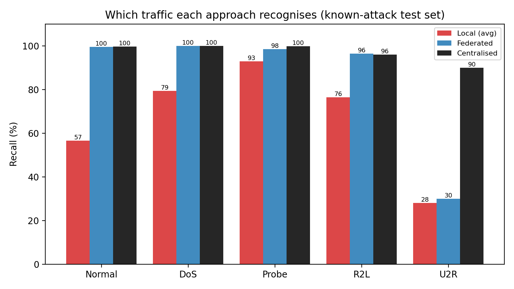
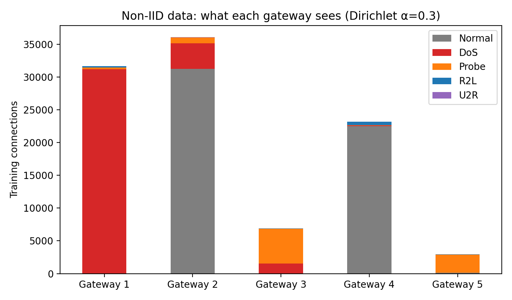

# Federated Learning for Privacy-Preserving IoT Intrusion Detection

[](https://colab.research.google.com/github/nafees-iiit/federated-iot-intrusion-detection/blob/main/federated_ids.ipynb)

Five IoT gateways learn **one shared intrusion detector without ever sharing their traffic data**,
using Federated Averaging (FedAvg) — and every gateway ends up far better than training alone.

**Author:** Mohammad Nafees, Ph.D. Scholar (ECE), MNNIT Allahabad
**Related:** [ML intrusion detection for IoT gateways](https://github.com/nafees-iiit/iot-intrusion-detection-ml)

---

## 1. Problem

Each gateway (hospital, factory, campus, smart-home provider, city network) sees only its own
traffic — and mostly only a few attack types. Raw traffic cannot be pooled (privacy law, business
secrets, bandwidth). A model trained alone misses attacks that gateway has never seen.

## 2. Setup

- **Data:** NSL-KDD (downloaded automatically). 5 classes: Normal, DoS, Probe, R2L, U2R.
- **Non-IID split:** training data divided across 5 gateways with a Dirichlet(α = 0.3) split:

| Gateway | Normal | DoS | Probe | R2L | U2R |
|---|---:|---:|---:|---:|---:|
| Gateway 1 | 0 | 31,189 | 278 | 181 | 0 |
| Gateway 2 | 31,232 | 3,911 | 913 | 0 | 23 |
| Gateway 3 | 0 | 1,526 | 5,341 | 9 | 1 |
| Gateway 4 | 22,529 | 113 | 28 | 542 | 0 |
| Gateway 5 | 113 | 2 | 2,765 | 64 | 18 |

- **Model:** the same neural network everywhere (MLP 122 → 64 → 32 → 5).
- **Federated pre-processing:** one-hot encoding with the public protocol vocabulary; global
  mean/std computed from per-gateway sums only.
- **Compared:** local-only training (each gateway alone), **FedAvg** (30 rounds, 1 local epoch,
  size-weighted averaging), and centralised training on pooled data (privacy-violating upper bound).
- **Tests:** a held-out 20 % of KDDTrain+ (known attack types) and the official KDDTest+ (new attack types).

## 3. Results

| Model | Macro-F1 (known attacks) | Accuracy (known) | Macro-F1 (KDDTest+) | Accuracy (KDDTest+) |
|---|---:|---:|---:|---:|
| Local only - Gateway 1 | 0.302 | 0.463 | 0.323 | 0.434 |
| Local only - Gateway 2 | 0.717 | 0.989 | 0.499 | 0.757 |
| Local only - Gateway 3 | 0.309 | 0.464 | 0.289 | 0.428 |
| Local only - Gateway 4 | 0.726 | 0.951 | 0.462 | 0.712 |
| Local only - Gateway 5 | 0.351 | 0.551 | 0.408 | 0.542 |
| Local only (average of 5 gateways) | 0.481 | 0.684 | 0.396 | 0.574 |
| Federated (FedAvg) | 0.862 | 0.995 | 0.569 | 0.785 |
| Centralised (all data pooled) | 0.920 | 0.998 | 0.609 | 0.794 |




**Key findings**

- Training alone, the average gateway reaches **macro-F1 0.48**; gateways that never saw normal
  traffic (GW 1, GW 3) label almost everything as an attack.
- **FedAvg reaches 0.86 — 94 % of the centralised model (0.92) — without moving any raw data.**
- Only **0.40 MB of model weights per round** (12 MB in total) are exchanged, versus 98 MB of raw features
  that would have to be pooled.
- Honest gap: **U2R** (only 42 training samples spread over gateways) is still detected only 30 % of the time
  by FedAvg vs 90 % centrally — averaging dilutes very rare classes. Fixes: class re-weighting,
  FedProx, or sharing rare-class statistics.




## 4. How to run

```bash
git clone https://github.com/nafees-iiit/federated-iot-intrusion-detection.git
cd federated-iot-intrusion-detection
pip install -r requirements.txt
python federated_ids.py      # downloads NSL-KDD (~22 MB) on first run
```

Or click **Open in Colab** above → **Runtime → Run all** (≈ 1 minute).

## 5. Limitations and next steps

- Simulated federation on one machine; no real network delays or dropped clients.
- No formal privacy guarantee yet — next: secure aggregation and differential privacy.
- Next: FedProx / class-balanced aggregation for rare attacks, IoT-specific datasets (CIC-IoT2023, TON_IoT).

## License

Code: MIT. Dataset: NSL-KDD, © Canadian Institute for Cybersecurity — see its original terms.
